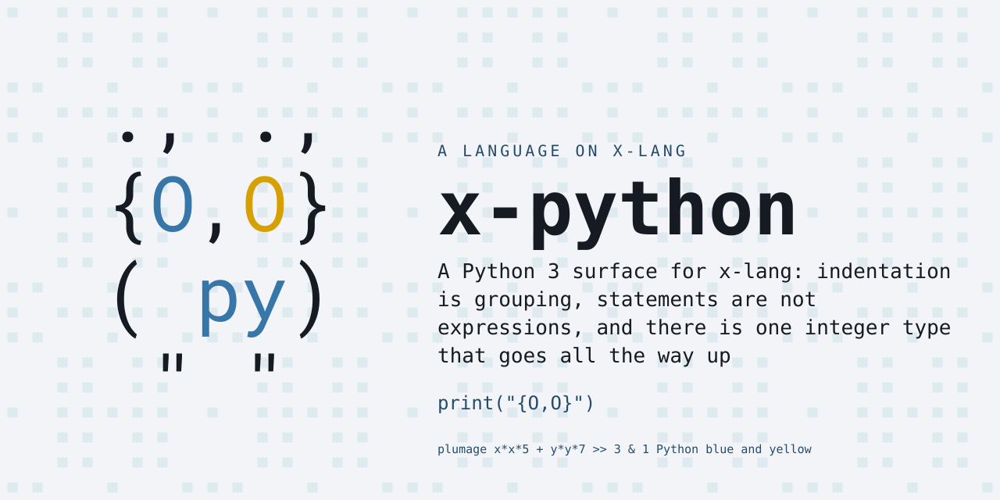
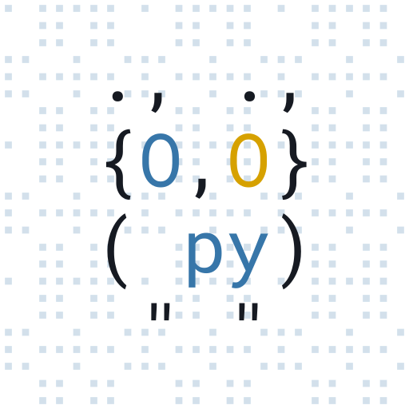

# x-python — Python on x-lang

<p align="center"></p>

A Python 3 surface for [x-lang](https://github.com/jonruttan/x-lang):
indentation is grouping, statements are not expressions, and there is one
integer type that goes all the way up.

```python
$ x -l python
>>> def fact(n):
...     return 1 if n <= 1 else n * fact(n - 1)
>>> print(fact(20))
2432902008176640000
```

x-python is a **lang**: a different surface language loaded over an x-lang
dialect. Where x-lang and Python spell something the same way, Python is free
to mean something different by it — `#` opens a comment here, and `'` opens a
string. The terms are in x-lang's
[lang contract](https://github.com/jonruttan/x-lang/blob/main/docs/lang-contract.md).

## Status

Two suites measure it.

**The bundle's own suite**: 1,198 tests, 0 failed, 2 pending, across 129
spec files (CI on `main`, 2026-11-10, against x-lang v0.46.0 and against
x-lang `main`). It covers the tokenizer and line structure, expressions and
statements, scope, the operator protocol, exact integers, floats and complex
numbers, `str` and its methods, f-strings and `%` formatting, `bytes`,
`bytearray` and `memoryview`, lists, tuples, dicts and sets, slicing,
comprehensions, functions, keyword arguments and decorators, generators and
`yield from`, classes with multiple bases, `super`, descriptors and the
special-method hooks, exceptions, `with`, `import`, `eval` and `exec`, and
the interactive session.

**The conformance suite**: 592 of 646 cases pass (last recorded 2026-10-17).
Each case is a whole Python program from MicroPython's test corpus, compared
on its whole stdout against a CPython 3.14 run. CI does not run it: the run
is serial and takes about an hour. `make score` prints the table by group,
worst first.

The built-in modules a program can import are `array`, `builtins`, `cmath`,
`collections`, `errno`, `gc`, `io`, `math`, `os`, `struct`, `sys` and
`types`. The rest of the standard library is absent.

It is paired with x-lang v0.53.0; `lang.xon` is the row that says so. No
release has been cut.

## The conformance suite

Python has no vendor-neutral conformance suite. The de-facto standard is
CPython's `Lib/test`, which is unittest-based, so `unittest`, `io` and much
of the standard library must work before the first assertion runs; it is
dense with `@cpython_only` and `impl_detail`; and it is PSF-licensed rather
than MIT.

MicroPython's `tests/` was written for a subset implementation. At v1.29.0:

| suite | `.py` files | run under CPython 3.14 unmodified |
|---|---:|---:|
| `basics/` | 576 | 562 |
| `float/` | 69 | 69 |
| `import/` | 30 | 30 |
| `unicode/` | 25 | 21 |
| | 700 | 682 |

The files are small, import nothing, and assert by printing: one program,
one stdout blob, which is the layout of a `.spec.md` case. Only 65 of the
576 in `basics/` carry a `.exp` file; for the rest upstream generates the
expectation by running CPython, and so does this bundle.

CPython is the oracle, not MicroPython. Where CPython refuses a file,
upstream's `.exp` records MicroPython's own behaviour, and those files are
excluded. Of the 700, 646 become spec cases. The 54 that do not are listed
by name and reason in `tests/conformance/SKIPPED.md`, which `make gen`
writes.

## Install

No release has been cut, so there is no pin for `x --install-lang` to
fetch. From a clone:

```bash
make install                      # into the x on your PATH
PREFIX=$HOME/.local make install  # or a particular prefix
```

`make uninstall` removes it again. An installed x searches
`<share>/langs/*/lang.xon`, so a lang is installed when its files are there.

Inside an x-lang checkout, `x` searches that checkout's `deps/langs/` and
does not see an installed lang. `X_LANG_DIR` names the bundles explicitly in
either case:

```bash
X_LANG_DIR=$HOME/.local/share/x/langs/ x -l python   # the installed one
X_LANG_DIR=/path/to/x-python/.. x -l python          # a checkout, uninstalled
```

## Running it

```bash
x -l python                  # interactive
x -l python -f program.py    # batch
```

x-lang boots the dialect `lang.xon` declares, arms this bundle's module root,
and loads `run.x` on top.

`make install` ends with `x --image -l python`, which writes the booted lang
to a state image; `x -l python` then loads the image instead of reading the
sources, for as long as the image's key matches the library and engine.
`x --no-image -l python` boots from source.

## The prompt

With a terminal, the prompt is x-lang's line editor reading Python: arrow
keys and the readline chords, history that outlives the session, Tab over the
keywords and builtins, and colour applied as you type — keywords, literals,
comments, decorators, and brackets by nesting depth with the pair beside the
cursor marked. A line ending in `:` opens a block that continues under `...`
until a blank line, as CPython's own prompt does.

The bundle registers all of that as the lang `"python"` with x-lang's
`x/repl/lang`, which is what lets one session hold both prompts:

```
>>> def sq(n):
...     return n * n
...
>>> lang("x")
> (py-sq 12)
144
> (lang python)
>>> sq(12)
144
```

Python's names live in the shared base under a `py-` prefix, so a value or a
function made at one prompt is there at the other. `lang("x")` is Python's
spelling of the switch and `(lang python)` is x-lang's; both are calls to the
same registry.

Without a terminal — a pipe — there is no editor, and the bundle's own loop
reads Python from stdin, block by block, as before.


## Development

```bash
X=/path/to/x-lang/x.sh make test        # the bundle's own suite
X=/path/to/x-lang/x.sh make test-boot   # one program through `x -l python`
make gen                                # fetch the pinned corpus, generate tests/conformance/
make score                              # pass/total per group, worst first
make conformance                        # the same run, case by case
make clean                              # drop deps/ and tests/conformance/
```

Without `X` the suite takes the `x` on `PATH`. An installed x older than the
checkout reports failures the platform has since fixed.

`make test-boot` boots through the wrapper on the dialect `lang.xon`
declares, from source, and runs a short program. The suite loads the bundle
on the full-tower amalgam, which binds more platform names than that dialect
does, so a name the bundle reads and never imports shows only under
`test-boot`, as `Unbound SYMBOL`.

`make install` asks `$(X) --share-dir` where to put the bundle. A checkout
answers with its own root, which is not a path `-l` searches there: install
into a `<share>` tree, or use `X_LANG_DIR`.

The conformance run is serial: `score.sh` sets `PARALLEL=1`, because the
per-process allocation ceiling bounds one interpreter and the platform
runner would otherwise start one per CPU. It wants a machine running no
other x suite; under memory pressure cases fail that pass alone. A single
group runs with
`sh tests/spec-runner.sh tests/conformance/GROUP.spec.md`.

`make gen` runs CPython twice over every program in the corpus, at
`PYTHONHASHSEED=0` and at `1`, and excludes any whose output differs.

Nothing generated is committed. `deps/` is the fetched corpus, verified
against the digest in `tools/conformance/upstream.pin.xon`;
`tests/conformance/` is derived from it and from the CPython that was the
oracle. `make clean` drops both.

## Design notes

- [Python values on x's type system](docs/values-on-the-type-system.md):
  Python's values are x types, registered on the running base.
- [NUL bytes and the string layer](docs/nul-and-the-string-layer.md): how a
  `str` and a `bytes` carry a NUL.

## Layout

```
docs/                        design notes
lang.xon                     name, dialect, release pairing, grammar
run.x                        the entry
python/base.x                the language, assembled
python/core.x                the core: one module in several files
python/tokens.x              the lexical layer, on its own tokenizer base
python/parse.x               tokens to forms
python/types.x               Python's values, as x types
python/str.x                 the code point sequence, and the codec under it
python/bytes.x               the byte sequence, and the algorithms over it
python/memoryview.x          memoryview
python/format.x              the % string-formatting operator
python/runtime-num.x         arithmetic, the operator protocol, numeric builtins
python/runtime-seq.x         comparison, lists, dicts and iteration
python/runtime-str.x         attributes, str's methods, the format-spec language
python/runtime-obj.x         print, float repr, complex, exceptions and classes
python/runtime-call.x        keyword calls, super, sets, the rendering builtins
python/runtime-flow.x        modules, with, tuples and generators
python/runtime-py-type.x     type objects, constructors and slicing
python/util.x                list walks the bundle shares
python/array.x  cmath.x  collections.x  deque.x  io.x  os.x  struct.x  sys.x
                             the importable modules
python/repl.x                the interactive session
python/line.x                the line editor's seams
python/lexer.x  syntax.x     the highlighting grammar
tests/spec-runner.sh         sources the platform's shared runner
tests/gen-harness.sh         writes tests/lib/harness.gen.x (generated)
tests/boot.sh                what `make test-boot` runs
tests/specs/                 the bundle's own suite
tests/modules/               the modules and files the import and io specs read
tools/conformance/
  upstream.pin.xon           the corpus: commit, digest, licence, suites
  fetch.sh                   fetch, verify, unpack into deps/
  gen-specs.sh  gen-specs.py corpus -> .spec.md, with CPython as oracle
  score.sh                   the ranked table
tools/check/                 the if-ladder check CI runs
```

## Dialect

`lang.xon` declares helium, and the bundle imports the libraries Python's
data model needs:

- Python 3 has one integer type and it is arbitrary-precision: `2 ** 200` is
  neither an error nor a float. That is `x/num/bigint`.
- `1 / 2` is `0.5`: true division always produces a float. That is
  `x/num/tower`.

The numeric tower loads with its analysers compiled
(`x/boot/tower-compiled`), through x-lang's own assembler.

## Background

Python is Guido van Rossum's language, first released in 1991; Python 3 (2008)
is the only target here, and it is the version that made the choices this
bundle's dialect note leans on — one unbounded integer type, true division,
text as Unicode. Python has a reference manual rather than a standard, and its
behaviour is ultimately defined by what CPython does — which is why the
scoreboard above treats CPython as the oracle rather than any document.

- [The Python Language Reference](https://docs.python.org/3/reference/) — as close to a specification as exists
- [Data model](https://docs.python.org/3/reference/datamodel.html) — the chapter an implementer actually lives in
- [MicroPython](https://micropython.org/) — the subset implementation whose test corpus this bundle scores against

## Licence

MIT No Attribution (MIT-0). See [LICENSE](LICENSE).

The MicroPython corpus this bundle scores against is MIT and is **not** vendored
here — it is fetched and verified from the pin in
`tools/conformance/upstream.pin.xon`.

<p align="center"></p>
